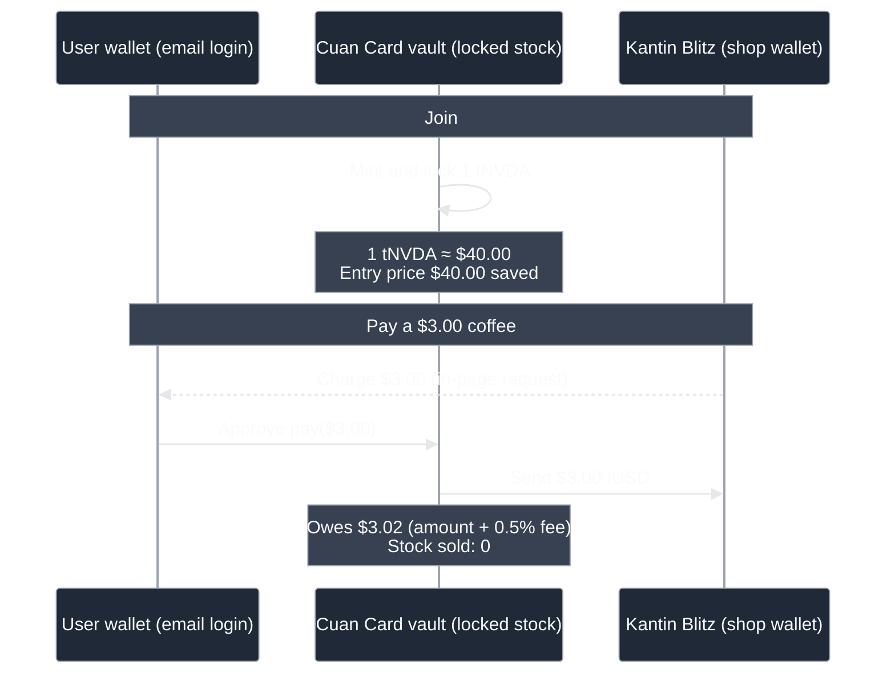

# CuanLater · Cuan Card

**Jajan pakai saham, bayar pakai cuan.**
Pay at a shop with your stock, without selling it. When your stock goes up, the profit pays the bill.

Built at Monad Blitz Jogja Vol. 2. Runs on Monad testnet.

- **App:** https://www.cuanlater.xyz/
- **Demo video:**

https://github.com/user-attachments/assets/c5e2e355-982a-4ea6-afef-68e7879d114f

- **Single-screen demo:** https://www.cuanlater.xyz/demo

[](https://youtu.be/eGK_doZtM1M)

> Never run a web3 app before? Jump to [Run it locally](#run-it-locally). It takes about 2 minutes: clone, install, run.

## How it works

1. **You join.** You get 1 tNVDA (a demo stock worth $40). It stays locked as your guarantee.
2. **You pay.** Tap your Cuan Card at the shop, or scan the shop's QR. The shop gets paid right away.
3. **Nothing is sold.** Instead, you owe a small debt (plus a 0.5% fee).
4. **Profit pays the debt.** When the stock price rises above where you started, the profit pays your debt for you. This is checked every block. We call it *Bayar pakai cuan*.
5. **No profit? No problem.** Pay back with cash, or with a little stock, whenever you like. There is no deadline while your loan is safe.

**Safety limits.** You can borrow up to 35% of your stock's value on weekdays, and 25% on weekends (stock markets are closed). The contract checks the date itself. Nobody can change it.

**Your starting value is never touched.** Only profit above what your stock was worth when you joined is sold.

### What happens when you pay



### How repayment and safety work

```mermaid
%%{init: {'theme': 'base', 'themeVariables': {'background': '#0d1117', 'primaryColor': '#1f2937', 'primaryTextColor': '#f9fafb', 'primaryBorderColor': '#9ca3af', 'lineColor': '#cbd5e1', 'secondaryColor': '#374151', 'tertiaryColor': '#111827', 'mainBkg': '#1f2937', 'textColor': '#f9fafb', 'actorBkg': '#1f2937', 'actorTextColor': '#f9fafb', 'actorBorder': '#9ca3af', 'actorLineColor': '#9ca3af', 'signalColor': '#e5e7eb', 'signalTextColor': '#f9fafb', 'labelBoxBkgColor': '#1f2937', 'labelBoxBorderColor': '#9ca3af', 'labelTextColor': '#f9fafb', 'loopTextColor': '#f9fafb', 'noteBkgColor': '#374151', 'noteTextColor': '#f9fafb', 'noteBorderColor': '#9ca3af'}}}%%
sequenceDiagram
    participant U as User wallet
    participant V as Cuan Card vault
    participant T as Treasury
    participant A as Anyone (keeper or button)

    Note over U,A: Starts with $3.02 debt and 1 tNVDA locked

    rect rgb(31, 41, 55)
        Note over U,A: A · Price rises to $44 — profit pays
        A-->>V: harvestRange(0, n) (in-page request)
        V->>T: Sell 0.0686 tNVDA to treasury
        Note over V: Debt $0<br/>0.9314 tNVDA ≈ $40.98 left
    end

    rect rgb(31, 41, 55)
        Note over U,A: B · No profit — user repays in cash
        U->>V: Repay $3.02 tUSD
        Note over V: Vault holds the $3.02
    end

    rect rgb(31, 41, 55)
        Note over U,A: C · Debt exceeds 50% of stock — safety sell to under 35%
        A-->>V: liquidate(user) (in-page request)
        V->>T: Sell just enough tNVDA
    end

    rect rgb(31, 41, 55)
        Note over U,A: D · Debt reaches $0 — shares stay locked
        U->>V: withdraw(shares) — no screen yet
        V-->>U: Return remaining tNVDA
    end
```



Solid arrows are Monad transactions; dashed arrows are requests made inside the page. With a little stock, a user can repay at any price, not just when the stock is profitable.

## Try it online

**One screen:** open [/demo](https://www.cuanlater.xyz/demo). You see the phone, the shop terminal and the price chart side by side.

**Two screens:** open [/terminal](https://www.cuanlater.xyz/terminal) on a laptop and [/card](https://www.cuanlater.xyz/card) on your phone. Log in with your email. You don't need a wallet or any MON; we pay the network fees.

Things to try:

| Do this | What happens |
| --- | --- |
| Buy a coffee ($3.00) by card tap | Approved. You owe $3.02. Stock sold: 0. |
| Buy an es teh ($0.50) by QRIS | Approved. You owe $3.52. |
| Freeze your card, then buy a sticker ($5.00) | Declined: card frozen. Nothing charged. |
| Buy a T-shirt ($10.00) on a weekend | Declined: over today's limit. |
| Press **Start price replay** | Price goes from $40 to $44. Your $3.52 debt is paid by profit. You keep 0.9201 tNVDA ≈ $40.48. |

## Run it locally

You can run the whole app against the contracts we already deployed. No Solidity, no wallet setup for users, no MON needed to browse.

### What you need

| Tool | Why | Check |
| --- | --- | --- |
| [Node.js](https://nodejs.org) 24 or newer | runs the app and the keeper | `node -v` |
| Git | to clone the repo | `git --version` |
| [Foundry](https://getfoundry.sh) | **only** if you deploy your own contracts | `forge --version` |

You do **not** need a Privy or Pimlico account, a wallet, or any MON to run the demo. Our shared login and gas sponsorship are already filled in below. You only need your own accounts if you deploy your own copy (step 3).

If `node -v` shows an older version and you use `nvm`:

```bash
nvm install 24 && nvm use 24
```

### 1. Clone the repo

```bash
git clone https://github.com/CuanLater/CuanLater.git
cd CuanLater
```

### 2. Fill in `app/.env.local`

From the repo root:

```bash
cp app/.env.example app/.env.local
```

Open `app/.env.local` and paste this. The four addresses are our live deployment, so you can copy them as-is:

```dotenv
# Monad testnet (chain ID 10143)
NEXT_PUBLIC_CHAIN_ID=10143
NEXT_PUBLIC_RPC_URL=https://testnet-rpc.monad.xyz
NEXT_PUBLIC_RPC_FALLBACK_URL=https://rpc.ankr.com/monad_testnet
NEXT_PUBLIC_EXPLORER_URL=https://testnet.monadexplorer.com

# Our shared demo app: email login + gas paid for you. Public value, safe to share.
# Uses our free quota. Fine for trying it; create your own app before deploying (step 3).
NEXT_PUBLIC_PRIVY_APP_ID=cmvm002gz02y70gl57jwkzvnt

# Our deployed contracts. Use these to try the app; replace them if you deploy your own.
NEXT_PUBLIC_CUANLATER_ADDRESS=0xC83CF31497fe6e206B82FA35e16523Fb491774E5
NEXT_PUBLIC_STOCK_ADDRESS=0x6488cD402d12C14E19175ae0688349586BEe8e7A
NEXT_PUBLIC_USD_ADDRESS=0x3a73d22ff7547A020296B6b162B99798Af48a4dA
NEXT_PUBLIC_SHOP_ADDRESS=0xF977F34dB8a986A0A9edec3E744092c715EF793c
```

That is everything you need. The App ID is a public value: it already ships inside the website's JavaScript, so it is safe to have here. What is **not** public is the Pimlico API key, which stays in the Privy dashboard and never goes in this repo.

Every variable is explained in [Environment variables](#environment-variables).

### 3. Optional: use your own Privy app

Skip this if you are just trying the app or running the keeper: the block above already logs users in and pays the gas. Do this if you are deploying your own copy, want your own quota, or the shared demo app stops working.

CuanLater uses **Privy** for email login and smart wallets, and **Pimlico** as the paymaster that pays the network fee. Both have free plans and Pimlico's testnet sponsorship is free. No credit card.

Menu names in these dashboards change from time to time. Look for the bolded labels; if a label moved, it is usually one screen away.

**a. Create a Privy app**

1. Sign in at <https://dashboard.privy.io>.
2. **Create app** → name it anything, e.g. `CuanLater dev`.
3. Open **Configuration → App settings → Basics** and copy the **App ID** (a long string like `cla06f34x…`).
4. Paste it into `NEXT_PUBLIC_PRIVY_APP_ID` in `app/.env.local`.

**b. Turn on email login**

1. In the Privy dashboard, open the **Login methods** page (under **Configuration**).
2. Enable **Email**. The app sends a one-time code, so no password is needed.

**c. Get a Pimlico API key**

1. Sign in at <https://dashboard.pimlico.io>.
2. Open **API keys → Create API key** and copy it.
3. Your Monad testnet endpoint is:

   ```text
   https://api.pimlico.io/v2/10143/rpc?apikey=YOUR_PIMLICO_KEY
   ```

   Use the same URL for both the bundler and the paymaster. Treat this URL like a password: it goes in the Privy dashboard, not in this repo.

**d. Connect Pimlico to Privy**

1. In the Privy dashboard, open **Wallet Infrastructure → Smart Wallets**.
2. Enable smart wallets if you are asked to, then choose **Add a new chain → Custom chain**.
3. Fill it in like this:

   | Field | Value |
   | --- | --- |
   | Name | `Monad Testnet` |
   | Chain ID | `10143` |
   | RPC URL | `https://testnet-rpc.monad.xyz` |
   | Bundler URL | your Pimlico URL from step c |
   | Paymaster URL | your Pimlico URL from step c |

4. **Save**.

**e. Test it**

Start the app (step 4), open <http://localhost:3000/card>, log in with your email, and join. The code can take a minute and may land in spam. If login works but joining hangs, the smart-wallet chain or the paymaster URL is usually the culprit: see [If something goes wrong](#if-something-goes-wrong).

### 4. Start the app

From the repo root:

```bash
cd app
npm install
npm run dev
```

Open <http://localhost:3000/demo>. The left side is the phone, the right side is the shop terminal. Log in **inside the phone**, then charge a coffee and approve it on the phone.

If you change `app/.env.local`, stop the dev server with `Ctrl+C` and start it again. Next.js only reads env files at boot.

### 5. Optional: run the keeper

The keeper is a small bot that asks the contract to check for profit every block. Without it, profit still pays your debt when you press **Harvest now** on `/demo`, but nothing happens automatically.

Open a **second terminal** at the repo root:

```bash
cd keeper
cp .env.example .env
```

Fill in `keeper/.env`:

```dotenv
RPC_URL=https://testnet-rpc.monad.xyz
KEEPER_PRIVATE_KEY=0xYOUR_PRIVATE_KEY
CHAIN_ID=10143
# optional: defaults to deployments/10143.json
CUANLATER_ADDRESS=
```

You need a throwaway wallet with testnet MON. Use any EVM wallet (MetaMask → *Account details → Show private key*) or, if you installed Foundry, generate one:

```bash
cast wallet new          # prints a new address + private key
```

Then put the address into the [Monad faucet](https://faucet.monad.xyz) and start the keeper:

```bash
npm install
npm run keeper
```

You should see `keeper watching 0x… on chain 10143`, and later lines like `harvested 1 users, paid $3.52 (0x…)`.

**Keep this wallet above the Monad reserve.** Monad keeps **10 MON reserved** in accounts that send transactions, so a keeper wallet needs roughly **15–20 MON** to keep sending every block. The faucet is free, so top it up if transactions start failing.

### 6. Optional: deploy your own contracts

Use this if you want a clean tape, your own shop, or to change the price replay. You need Foundry and a funded testnet key.

From the repo root:

```bash
# install Foundry once
curl -L https://foundry.paradigm.xyz | bash
foundryup

cd contracts
cp .env.example .env
```

Fill in `contracts/.env` (all five are required):

```dotenv
RPC_URL=https://testnet-rpc.monad.xyz
PRIVATE_KEY=0xYOUR_DEPLOYER_PRIVATE_KEY
TREASURY_ADDRESS=0xYOUR_TREASURY
OPERATOR_ADDRESS=0xYOUR_OPERATOR
SHOP_ADDRESS=0xYOUR_SHOP
```

| Variable | What it is |
| --- | --- |
| `PRIVATE_KEY` | The deployer wallet. Get one with `cast wallet new`, then fund it at <https://faucet.monad.xyz>. Keep 15–20 MON for the 10 MON reserve. |
| `TREASURY_ADDRESS` | Receives the stock shares that are sold when users repay or get liquidated. Any wallet you control. |
| `OPERATOR_ADDRESS` | A trusted wallet allowed to pay a user's debt on their behalf. Any wallet you control is fine for a demo. |
| `SHOP_ADDRESS` | The shop that is registered on-chain as "Kantin Blitz". It must match `NEXT_PUBLIC_SHOP_ADDRESS` in the app. |

Install the Solidity dependencies and deploy:

```bash
forge install foundry-rs/forge-std OpenZeppelin/openzeppelin-contracts@v5.6.1
forge script script/Deploy.s.sol --rpc-url monad_testnet --broadcast
```

The script prints four lines like `NEXT_PUBLIC_CUANLATER_ADDRESS=0x…`. Paste them into `app/.env.local`, restart the app, and (if you use it) set `CUANLATER_ADDRESS` in `keeper/.env`.

It also writes the addresses to `deployments/10143.json`. That file is committed with **our** deployment, so do not commit your local change unless you mean to replace it.

## Environment variables

There are three env files. You only need the first one to run the app.

| File | Used by | Must fill in |
| --- | --- | --- |
| `app/.env.local` | the website | the 4 contract addresses (the Privy App ID is already filled in) |
| `keeper/.env` | the keeper bot | `RPC_URL`, `KEEPER_PRIVATE_KEY` |
| `contracts/.env` | deploying contracts only | all five |

`.env.example` files are templates and are committed. Your real values go in `.env.local` / `.env`, which git ignores. Never commit a private key or an API key.

### `app/.env.local`

| Variable | Required? | What it does |
| --- | --- | --- |
| `NEXT_PUBLIC_PRIVY_APP_ID` | **Yes** (pre-filled) | Our shared demo app for email login and gas sponsorship. Public value. Replace it with your own app ID if you deploy. Empty = local burner wallet (Anvil only). |
| `NEXT_PUBLIC_CUANLATER_ADDRESS` | **Yes** | The vault contract. |
| `NEXT_PUBLIC_STOCK_ADDRESS` | **Yes** | tNVDA, the demo stock. |
| `NEXT_PUBLIC_USD_ADDRESS` | **Yes** | tUSD, the demo dollar. |
| `NEXT_PUBLIC_SHOP_ADDRESS` | **Yes** | The registered shop. Must match the shop address in the contract. |
| `NEXT_PUBLIC_CHAIN_ID` | No | Defaults to `10143` (Monad testnet). Use `31337` for a local Anvil chain. |
| `NEXT_PUBLIC_RPC_URL` | No | Defaults to the public Monad testnet RPC. Set your own if you hit rate limits. |
| `NEXT_PUBLIC_RPC_FALLBACK_URL` | No | Second RPC used when the first fails. Defaults to the public RPC too. |
| `NEXT_PUBLIC_EXPLORER_URL` | No | Defaults to `https://testnet.monadexplorer.com`. Used for transaction links. |

### `keeper/.env`

| Variable | Required? | What it does |
| --- | --- | --- |
| `RPC_URL` | **Yes** | Monad testnet RPC, e.g. `https://testnet-rpc.monad.xyz`. |
| `KEEPER_PRIVATE_KEY` | **Yes** | `0x`-prefixed private key of a funded wallet. Use a throwaway wallet, never your main one. |
| `CHAIN_ID` | No | Defaults to `10143`. |
| `CUANLATER_ADDRESS` | No | Defaults to `cuanLater` in `deployments/<CHAIN_ID>.json`. |

### `contracts/.env`

| Variable | Required? | What it does |
| --- | --- | --- |
| `RPC_URL` | **Yes** | Used by the `monad_testnet` RPC alias in `foundry.toml`. |
| `PRIVATE_KEY` | **Yes** | Deployer wallet. Needs 15–20 MON for gas + reserve. |
| `TREASURY_ADDRESS` | **Yes** | Receives stock sold during repayments and liquidations. |
| `OPERATOR_ADDRESS` | **Yes** | Wallet that may pay a user's debt on their behalf. |
| `SHOP_ADDRESS` | **Yes** | Shop registered on-chain; must match the app's `NEXT_PUBLIC_SHOP_ADDRESS`. |

## If something goes wrong

| Symptom | Likely cause | Fix |
| --- | --- | --- |
| `next: command not found` / `npm ERR!` on start | dependencies not installed | `cd app && npm install` |
| `EBADENGINE` or weird syntax errors | Node is older than 24 | `nvm install 24 && nvm use 24`, then `npm install` again |
| Login form does nothing / no code arrives | email login is off, or the app is the wrong one | use the shared App ID from step 2, or enable Email login on your own app, then restart the dev server |
| Shared demo app stops sending codes, or payments suddenly fail | our free Privy/Pimlico quota ran out | create your own app (step 3) and put its App ID in `app/.env.local` |
| Privy error `invalid_origin` | this origin is not allowed for your Privy app | add `http://localhost:3000` (and your production domain) under **App settings → Domains** |
| Logged in, but "Wallet is still loading" forever | Privy cannot create a smart wallet on this chain | add Monad testnet (`10143`) under **Smart Wallets**, with both Pimlico URLs |
| Payment hangs, or a "user operation" / paymaster error | gas is not being sponsored | check the Pimlico key and URL; check you still have free testnet quota |
| `NOT_JOINED` revert | you have not joined yet | open `/card` and join first (you get 1 tNVDA) |
| "Declined: card frozen" or "over today's limit" | the safety rules are doing their job | unfreeze the card, or charge a smaller amount. Weekends allow 25%, weekdays 35% |
| Profit never pays the debt | replay not started, replay finished, or keeper not running | press **Harvest now**; press **Start price replay**; start the keeper |
| **Start price replay** is greyed out | not logged in on the phone, or the replay is still running | log in inside the phone and wait for the current replay to end |
| Deploy or keeper transactions fail with "insufficient funds" | Monad keeps 10 MON in reserve | keep 15–20 MON in that wallet; refill from the faucet |
| `forge: command not found` | Foundry is not installed | install it, run `foundryup`, then reopen the terminal |
| Port 3000 already in use | another dev server is running | stop it, or run `npm run dev -- -p 3001` |
| Keeper exits with "Set CUANLATER_ADDRESS or deploy first" | no address found for that chain | deploy, or put the vault address in `keeper/.env` |

**About the shared deployment:** the contracts in this README are shared by everyone who tries the demo. The price tape, the member list and the pool are global. If the tape has already reached $44, **Start price replay** may do nothing useful, and you cannot reset it without the owner key. Deploy your own contracts (step 6) if you want a clean slate.

## Contracts (Monad testnet, chain ID 10143)

All contracts are verified (Sourcify, exact match).

| Contract | Address |
| --- | --- |
| CuanLater (the vault) | [`0xC83CF31497fe6e206B82FA35e16523Fb491774E5`](https://testnet.monadvision.com/address/0xC83CF31497fe6e206B82FA35e16523Fb491774E5) |
| MockStock (tNVDA) | [`0x6488cD402d12C14E19175ae0688349586BEe8e7A`](https://testnet.monadvision.com/address/0x6488cD402d12C14E19175ae0688349586BEe8e7A) |
| MockUSD (tUSD) | [`0x3a73d22ff7547A020296B6b162B99798Af48a4dA`](https://testnet.monadvision.com/address/0x3a73d22ff7547A020296B6b162B99798Af48a4dA) |
| Shop: Kantin Blitz | [`0xF977F34dB8a986A0A9edec3E744092c715EF793c`](https://testnet.monadvision.com/address/0xF977F34dB8a986A0A9edec3E744092c715EF793c) |

The same addresses are in [`deployments/10143.json`](deployments/10143.json).

## What's real and what's pretend

**Real**
- The contracts on Monad testnet. Every payment, decline and payback is a real on-chain transaction.
- The weekday and weekend limits.
- Email login, with network fees paid for you.

**Pretend**
- tNVDA is a demo token, not a real Nvidia share. The price is a recorded **replay**, not live.
- tUSD is a demo dollar.
- QRIS is simulated. The QR code holds a CuanLater payment link, not a real QRIS code.
- The card says **Sandbox**. There is no real Visa or Mastercard card.
- A small script (the "keeper") asks the contract to check profits every block. Anyone can do this.

## Project layout

| Folder | What's inside |
| --- | --- |
| `app/` | Next.js frontend: `/demo`, `/terminal`, `/card`, and the shared wallet/provider code. |
| `contracts/` | Solidity vault, mock tokens, deploy script and Foundry tests. |
| `keeper/` | Node script that triggers profit payback every block. |
| `deployments/` | Deployed contract addresses per chain. |
| `specs/` | Product, testing and demo-runbook specs. |

## Tests

If you have not installed the Solidity dependencies yet, run the `forge install` line from step 6 first.

```bash
(cd contracts && forge test)             # 28 contract tests, all from specs/04-testing.md
node --test app/lib/format.test.ts       # money formatting
```

## Built with

| Part | Version |
| --- | --- |
| Solidity | 0.8.38 |
| Foundry | 1.8.6 |
| OpenZeppelin Contracts | 5.6.1 |
| Next.js | 16.4.3 |
| React | 19.3.1 |
| Tailwind CSS | 4.3.3 |
| Privy (email login, smart wallets) | 3.51.0 |
| Pimlico (pays network fees) | — |
| viem | 2.57.8 |
| Node | 24 |

## Notes for judges

- **When profit pays:** the keeper pays a debt only when the profit covers all of it. This sells the fewest shares. Anyone can also press **Harvest now** to pay with whatever profit there is.
- **Extras that work:** daily spending limit, pay back with stock, loan health bar. The safety sell, tap limit and operator payback are in the contract and tested, but have no screen yet.
- **Not built:** pay back in rupiah (Midtrans), mainnet.

## Team

CuanLater
